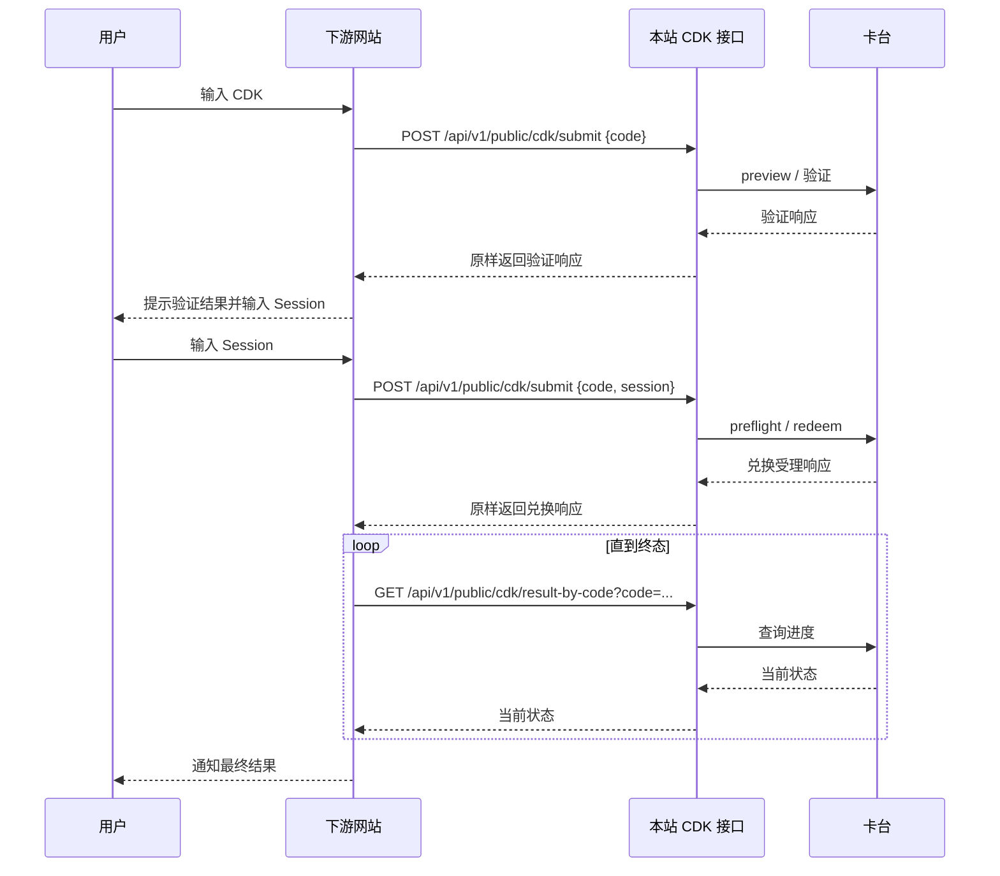

# 下游 CDK 提交接口对接文档

本文档说明下游网站如何让用户提交 CDK 和 Session，并调用本站完成验证、排队兑换和结果查询。

## 1. 对接范围

接口按照“一张 CDK 对应一个 Session”的流程工作：

1. 用户在下游网站输入一张真实 CDK，下游提交 `code`，本站执行 CDK 预览和验证。
2. 下游根据第一步的响应提示用户输入对应的 Session。
3. 下游用同一个 `code` 加上 `session` 再提交一次，本站自动执行预检和兑换。
4. 兑换通常是异步受理。下游继续查询结果，在订单进入终态后通知用户。

本接口不负责生成 CDK、不管理余额、不接收批量数组，也不要求下游传入 API Key、`request_id` 或 `batch_id`。每次请求只处理一张 CDK；如果下游一次要处理多张，请在下游自己的任务队列中逐张调用接口，避免并发提交同一张 CDK。

## 2. 接口信息

| 项目 | 内容 |
| --- | --- |
| 方法 | `POST` |
| 路径 | `/api/v1/public/cdk/submit` |
| 请求类型 | `application/json` |
| 默认 Docker 地址 | `http://服务器地址:8080` |
| 完整地址 | `http://服务器地址:8080/api/v1/public/cdk/submit` |
| 认证 | 按当前需求不需要 API Key 或 Bearer Token |
| 单次请求 | 一张 CDK；第二次请求携带这张 CDK 对应的一个 Session |

生产环境请将地址换成 HTTPS 域名，例如：

```text
https://cdk.example.com/api/v1/public/cdk/submit
```

## 3. 请求字段

请求体只允许以下两个字段，不能提交 `codes`、`request_id`、`batch_id` 等额外字段。

| 字段 | 类型 | 必填 | 说明 |
| --- | --- | --- | --- |
| `code` | string | 是 | 本站提前生成并发给用户的真实 CDK。最大 256 字节。两次请求必须使用完全相同的 CDK。 |
| `session` | string | 第一步否，第二步是 | 用户提交的 Session。最大 96 KiB，本站按不透明字符串转发，不要把它改成对象。 |

`code` 首尾空格会被去掉；不要在 CDK 中加入换行或控制字符。Session 如果本身是 JSON 文本，应作为字符串放进外层 JSON，例如：

```json
{
  "code": "真实CDK-001",
  "session": "{\"access_token\":\"example\"}"
}
```

不要把 CDK 或 Session 写入日志、分析平台、浏览器 `localStorage` 或 URL。它们都应当按敏感凭证处理。

## 4. 推荐调用流程



### 4.1 第一次提交：验证 CDK

请求：

```bash
curl -X POST "https://cdk.example.com/api/v1/public/cdk/submit" \
  -H "Content-Type: application/json" \
  --data '{"code":"真实CDK-001"}'
```

请求 JSON：

```json
{
  "code": "真实CDK-001"
}
```

本站会调用现有的 CDK preview 流程。验证成功后，本站保存这张 CDK 和上游 `redemption_token` 的绑定关系，第二次提交时下游不需要处理这个 token。

响应会透传卡台的 HTTP 状态码和 JSON 内容。卡台响应字段可能是 `code`、`msg`、`data`、`plan` 等组合，以下仅为示例，实际字段以当前响应为准：

```json
{
  "code": 0,
  "msg": "ok",
  "data": {
    "redemption_token": "由本站保存的内部令牌",
    "plan": "plus"
  }
}
```

下游应先判断 HTTP 状态码，再读取响应中的业务字段。只有验证通过并且确实允许兑换时，才向用户索要 Session。

如果 HTTP 是 2xx 但响应中没有 `redemption_token`（可能位于顶层，也可能位于 `data.redemption_token`），应把它当作本站或卡台响应异常，暂时不要继续第二步；联系管理员或稍后重试。下游不需要保存或回传这个 token，使用 `result-by-code` 查询即可。

### 4.2 第二次提交：提交 Session 并发起兑换

请求：

```bash
curl -X POST "https://cdk.example.com/api/v1/public/cdk/submit" \
  -H "Content-Type: application/json" \
  --data '{"code":"真实CDK-001","session":"用户账号凭证"}'
```

请求 JSON：

```json
{
  "code": "真实CDK-001",
  "session": "用户账号凭证"
}
```

本站内部会按现有流程完成：

1. 找到第一次提交保存的 `redemption_token`；如果第一次请求没有成功落库，本站会自动补做一次 preview。
2. 使用固定格式的 `credential` 调用 preflight：

   ```json
   {
     "mode": "session",
     "session": "用户账号凭证"
   }
   ```

3. 预检成功后，本站自动生成内部 `client_request_id`，调用 redeem。
4. 将 redeem 的 HTTP 状态码和 JSON 响应原样返回给下游。

下游不需要、也不应该自行生成 `redemption_token`、`preflight_token` 或 `client_request_id`。

第二次调用的响应表示“兑换请求已提交/受理”，不表示已经充值完成。示例：

```json
{
  "code": 0,
  "msg": "ok",
  "data": {
    "order": {
      "id": 456,
      "status": "awaiting_card",
      "stage": "cdk_accepted"
    }
  }
}
```

## 5. 最终结果查询

`submit` 不会自动等待卡台完成处理。第二次提交后，下游应使用以下接口查询同一张 CDK：

```http
GET /api/v1/public/cdk/result-by-code?code=真实CDK-001
```

示例：

```bash
curl "https://cdk.example.com/api/v1/public/cdk/result-by-code?code=%E7%9C%9F%E5%AE%9ECDK-001"
```

建议每 3～5 秒查询一次，设置总超时时间，例如 10 分钟。响应仍然是上游结果的 JSON，可能在 `data.order.status`、`data.status` 或顶层 `status` 中返回状态，因此下游解析时应兼容这些位置。

也可以使用第一次或第二次响应中得到的 `redemption_token` 查询：

```http
GET /api/v1/public/cdk/result?token=REDEMPTION_TOKEN
```

对下游而言，优先使用 `result-by-code` 更简单，因为下游不需要保存或处理 token。

### 5.1 状态判断

| 状态示例 | 下游处理 |
| --- | --- |
| `queued`、`awaiting_card`、`funding_pending`、`dispatching`、`running`、`requires_action`、`pending`、`plus_paid` | 继续查询，不要重复提交第二次请求 |
| `completed` | 兑换完成，向用户显示成功 |
| `declined`、`failed_precharge`、`cancelled` | 兑换进入失败终态。展示卡台返回的原因，并根据 `cdk_status`、资金状态等字段决定后续提示；不要只根据一个 `used` 字段判断是否可以再次提交 |
| 查询超时、网络断开、状态未知 | 先查询确认，不要直接重新发起兑换 |

只有明确收到 `completed`，才能向用户提示“充值成功”。HTTP `200`、HTTP `202`、`code: 0` 或 `status: queued` 都只表示请求被接受或正在处理。

## 6. 下游排队和幂等要求

接口本身不接收数组，也不创建服务端批次队列。下游如有多张 CDK，应自行维护队列：

1. 每次只发送一个 `code`。
2. 第一张 CDK 的验证和兑换流程完成或进入明确终态后，再处理下一张。
3. 同一张 CDK 不要并发发起两次第二步请求。
4. 如果第二步请求发生超时或连接断开，先调用 `result-by-code` 对账；确认没有订单后才考虑重试。
5. 重试时必须使用原来的 CDK、原来的 Session，并保持同一出口网络和设备标识。

第一步验证请求可以在网络失败后重试。第二步 redeem 可能已经被卡台受理，网络错误不能直接推断为失败。

## 7. 浏览器直连和服务端调用

### 7.1 下游服务端调用

推荐由下游服务端调用本站接口，再把脱敏后的状态返回给自己的前端。这样可以避免 Session 出现在浏览器历史、前端埋点和第三方脚本中。

服务端调用时，如使用 `X-Redemption-Device`，请在这张 CDK 的 preview、submit 和 result 请求中保持同一个值，并保持同一个出口 IP：

```http
X-Redemption-Device: downstream-site-01
```

如果不发送该请求头，本站会使用请求的 `User-Agent` 作为设备标识。多步流程不要中途更换设备标识或出口 IP。

### 7.2 浏览器直接调用

如果由下游浏览器直接请求本站，必须先把下游网页的 Origin 加入本站环境变量：

```env
CORS_ALLOWED_ORIGINS=https://downstream.example.com
```

多个来源用逗号分隔。修改后需要重建或重启容器：

```bash
docker compose up -d --build
```

浏览器直连时不要主动添加 `X-Redemption-Device`，因为当前 CORS 允许头列表没有开放这个自定义头；直接使用同一个浏览器的 User-Agent 即可。生产环境必须使用 HTTPS。

当前接口按需求不要求客户 API 认证，也没有在接口代码中增加客户级 IP 白名单。如果需要只允许固定下游服务器访问，建议在 Caddy、Nginx、WAF 或云安全组层限制来源 IP；这属于部署层配置，不改变请求格式。

## 8. JavaScript 示例

下面示例展示最小的两步流程。示例中的 `BASE_URL` 应替换为本站实际地址；不要把完整 Session 打印到控制台。

```js
const BASE_URL = "https://cdk.example.com";

async function submitCDK(payload) {
  const response = await fetch(`${BASE_URL}/api/v1/public/cdk/submit`, {
    method: "POST",
    headers: { "Content-Type": "application/json" },
    body: JSON.stringify(payload),
  });

  let body = null;
  try {
    body = await response.json();
  } catch {
    body = { error: "本站返回了非 JSON 响应" };
  }

  return { httpStatus: response.status, ok: response.ok, body };
}

// 第一步：验证 CDK
const preview = await submitCDK({ code: userCode });
if (!preview.ok) {
  throw new Error(preview.body?.error || "CDK 验证失败");
}

// 在页面上展示 preview.body 的验证结果，然后让用户输入 session
const redeem = await submitCDK({ code: userCode, session: userSession });
if (!redeem.ok) {
  throw new Error(redeem.body?.error || "兑换请求提交失败");
}

// redeem 成功只代表已受理；随后轮询 result-by-code
async function queryResult(code) {
  const url = `${BASE_URL}/api/v1/public/cdk/result-by-code?code=${encodeURIComponent(code)}`;
  const response = await fetch(url);
  const body = await response.json();
  return { httpStatus: response.status, ok: response.ok, body };
}
```

实际项目应给轮询增加间隔、最大次数和页面关闭后的任务恢复；不要用紧密循环持续请求。

## 9. 错误处理

| HTTP 状态 | 常见原因 | 下游处理 |
| --- | --- | --- |
| `400` | JSON 格式错误、缺少 `code`、字段过长、包含非法字符、提交了未知字段 | 修正请求后再提交，不要重复发送原请求 |
| `404` | `result-by-code` 尚未找到该 CDK 的绑定 | 确认第一步提交成功、CDK 完全一致；短暂延迟后可重查 |
| `500` | 本站查询绑定失败 | 记录本站返回的错误，不要连续重试；联系系统管理员 |
| `502` | 本站连接卡台失败，或上游响应缺少兑换所需 token | 第一步可稍后重试；第二步先查结果再决定是否重试 |
| 上游 `4xx` | CDK、Session 或兑换资格被卡台拒绝 | 将上游返回的业务原因展示给用户 |
| 上游 `5xx` | 卡台暂时不可用 | 按上面的对账规则处理，避免盲目重复 redeem |

本站对请求 JSON 使用严格字段校验。下面请求会返回 `400`，因为包含不支持的字段：

```json
{
  "code": "真实CDK-001",
  "request_id": "user-001"
}
```

## 10. 上线检查清单

- [ ] 下游使用真实 HTTPS 地址，而不是开发机 `localhost`。
- [ ] 第一、第二次请求使用完全相同的 `code`。
- [ ] 第二次请求只增加 `session`，没有自行传 `redemption_token`、`preflight_token` 或 `request_id`。
- [ ] 多张 CDK 由下游逐张排队，未并发提交同一张 CDK。
- [ ] 第二步收到 `queued`、`awaiting_card` 等状态后使用 `result-by-code` 查询，不重复提交。
- [ ] 只有 `completed` 才提示用户成功。
- [ ] CDK 和 Session 不写入日志、埋点、URL 或浏览器持久化存储。
- [ ] 服务端调用保持同一出口 IP 和设备标识；浏览器直连已配置 `CORS_ALLOWED_ORIGINS`。
- [ ] 如需 IP 白名单，已在反向代理、WAF 或安全组配置，而不是依赖接口请求字段。
